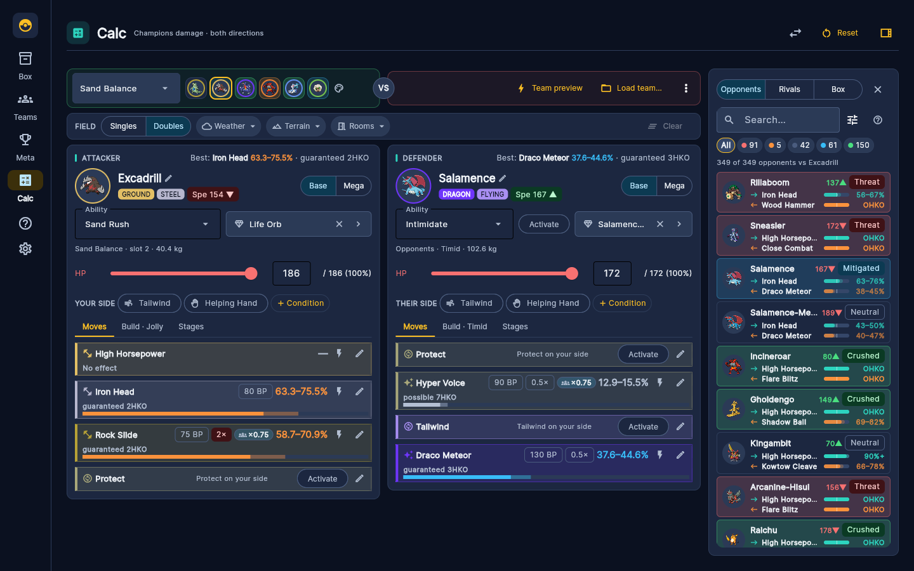
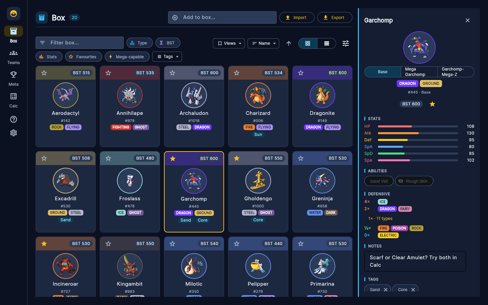
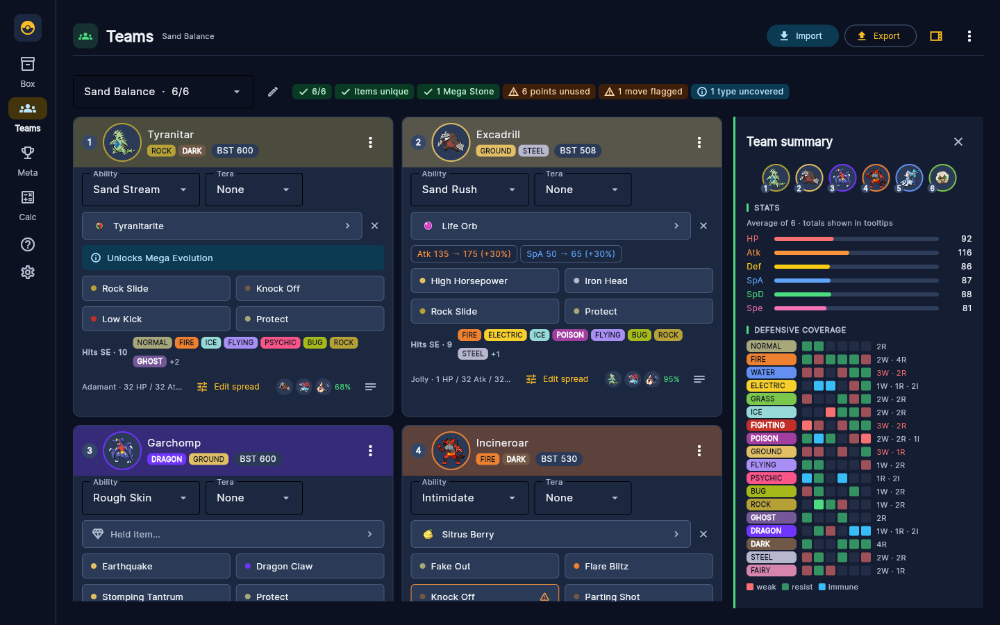
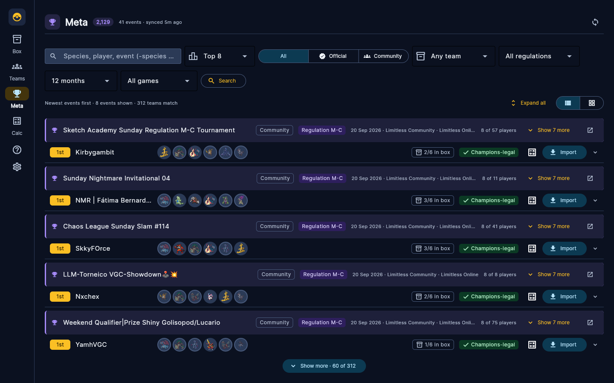

<p align="center">
  <picture>
    <source media="(prefers-color-scheme: dark)" srcset="assets/brand/lockup-horizontal-dark.svg">
    
  </picture>
</p>

# Champions MetaDesk Studio

**A desktop and web workbench for competitive Pokémon Champions (VGC) players: your box, your
teams, the live tournament meta and a two-way damage calculator in one app.**

[](https://github.com/JsNcAr/champions-metadesk-studio/actions/workflows/ci.yml)
[](https://github.com/JsNcAr/champions-metadesk-studio/releases/latest)
[](LICENSE)




Champions MetaDesk Studio keeps a player's roster, builds and meta research in one place.
Add the Pokémon you own, build teams with Champions' stat-point spreads and item rules, browse
real tournament teams from Limitless and Victory Road, and see how any matchup plays out in
both directions. It is written in Python with [Flet](https://flet.dev) (Flutter) for the UI and
SQLite for storage, runs as a native desktop app or in the browser, and ships as standalone
executables for Windows, macOS and Linux.

*Unofficial fan-made tool: not affiliated with Nintendo, Game Freak, Creatures Inc. or The
Pokémon Company ([details](#license-and-disclaimer)).*

## How it's verified

- **The damage engine is checked against the reference.** `domain/damage/` is a Python port of
  the Pokémon Champions module of Smogon's damage calculator, and it is replayed against
  **997 golden scenarios** generated by running the original calculator: every roll and every
  KO text must match ([fixtures](scripts/damage_fixtures/)).
- **643 automated tests** cover the domain rules, repositories, services and the UI. UI tests
  drive the views headlessly and push every control through Flet's real diff and serialisation
  path. A layout lint rejects control shapes that Flutter would refuse at runtime, such as an
  expanding child inside a wrapping row or one control placed in two parents.
- **CI on every push and pull request** runs the suite (failing on any leaked database
  connection), a lint for real errors, and a smoke test that builds all five views. The release
  workflow runs the same tests again and checks the tag against the version before it builds
  anything ([releasing](docs/releasing.md)).
- **Performance is measured, not assumed.** Query and rendering work was profiled against a
  year-scale synthetic database (1,200 tournaments, 66,000 teams) and verified in headless
  Chromium against the running app ([architecture](docs/architecture.md#rendering-performance),
  [testing strategy](docs/testing-strategy.md)).

## Features

| Box | Teams | Meta |
|---|---|---|
|  |  |  |

- **Box.** Add Pokémon by name (forms and Megas normalised), filter by type, stats, tags,
  favourites and Mega capability, and import or export the whole box as JSON, a names list or
  CSV.
- **Teams.** The whole team at a glance in six compact cards; one click opens a slot's editor
  in place: forms, abilities, items with Champions legality guardrails and stat deltas, legal
  moves ranked by tournament usage, and the Champions stat-point spread (0–32 per stat, 66 in
  total). An analysis panel covers health checks, level-50 stats and speed order, defensive
  and offensive coverage, and the team's roles (speed control, Fake Out, Intimidate…).
  A library shows every team with its six Pokémon, searchable and sorted by last edit.
  Showdown and Poképaste import and export. Each team is built
  for a **format** that decides which mechanics it shows: Champions has Mega Evolution, and
  custom formats (Settings) can switch on Terastallization.
- **Meta.** Tournament teams synced in the background from Limitless and Victory Road, grouped
  by event, filterable by species, player, regulation, placement and how many of the members
  you already own. Any team imports into the builder in one click. A **Top teams** tab ranks
  lineups by usage share (same six Pokémon and Mega Evolutions counts as the same team), with
  best finish, top-cut rate, a trend arrow and each slot's item spread; import the group's
  most common set, save it as a rival preset, or damage-calc against any member.
- **Calc.** Both directions at once, with each side's best hit and who moves first always in
  view. It covers the field (weather, terrain, rooms, screens, hazards and more), stat stages,
  statuses and critical hits, and classifies every Champions species against your attacker
  (Crushed, Threat, Wall, Mitigated, Neutral) using their most-used tournament sets. Turned
  around, it colours your own team by how each member fares against the rival you are
  checking. **Rival teams** keep presets to plan against (saved from Meta, your own teams, a
  paste or a Poképaste link) and the team you are facing now: enter the six species at team
  preview or load a preset into the battle, and each rival is one click from the Defender
  panel, keeps what the battle reveals, and shows up in a Team vs team grid of every pairing.
  Benchmarks say how many stat points a KO or a survival takes, and in Doubles spread moves
  are calculated on two targets, or one when only one foe is left.
- **Plans.** Each of your teams' matchup plans against common meta teams, like the matchup
  section of a team report. A plan holds the opposing six (from Meta's Top teams or Events,
  a Calc rival preset, a paste or a Poképaste link), how hard it is, the two you lead with
  and the two you keep in the back, your game plan, a note on each threat, a matchup grid of
  your six against theirs under a field you set (Tailwind, Stealth Rock, weather, Trick
  Room…), and pinned calcs that stay up to date as your sets change. The app runs the calcs;
  the plan is yours to write. A battle flow per plan says what you do for each lead they
  might show, turn by turn, with the damage of each attack and "If…" branches for when it
  goes wrong (lose your Mega on turn 1, and so on). Copy a plan, or all of a team's plans,
  as Markdown.

## Download

Standalone builds for Windows, macOS and Linux are attached to every
[release](https://github.com/JsNcAr/champions-metadesk-studio/releases/latest). No Python
needed. Release notes are in the [changelog](CHANGELOG.md).

**First launch.** The builds are not code-signed yet, so the system warns the first time:

- **Windows:** open the `champions-metadesk` folder from the zip and run `champions-metadesk.exe`.
  At "Windows protected your PC", click **More info**, then **Run anyway**.
- **macOS** (Apple Silicon): "can't be opened because Apple cannot check it" or "is damaged".
  Try to open it once, then **System Settings › Privacy & Security › Open Anyway**. On macOS 14
  and older, right-click the app and choose **Open**. If it still refuses:
  `xattr -dr com.apple.quarantine /path/to/ChampionsMetaDeskStudio.app`.
- **Linux:** `tar -xzf champions-metadesk-linux-x64.tar.gz`, then run
  `champions-metadesk-linux-x64/champions-metadesk/champions-metadesk`, or
  `./champions-metadesk-linux-x64/install.sh` for a menu entry with the icon (no sudo; `--uninstall`
  removes it). It needs GTK 3, which desktop Linux systems have.

Each release lists the archives' checksums in `SHA256SUMS.txt` (`sha256sum -c SHA256SUMS.txt`
on Linux, `shasum -a 256` on macOS, `Get-FileHash` on Windows).

A downloaded build keeps your data in your user folder, wherever you start it from:

| OS | Data folder |
|---|---|
| Windows | `%LOCALAPPDATA%\Champions MetaDesk Studio` |
| macOS | `~/Library/Application Support/Champions MetaDesk Studio` |
| Linux | `~/.local/share/champions-metadesk-studio` (or `$XDG_DATA_HOME`) |

Earlier builds kept it beside the program on Windows and Linux; the first launch of a newer
build copies that database and its preferences over and leaves the old files in place.
Settings › About shows the folder and opens it. Box exports go to your Downloads folder.

### Updates

Once a day the app asks GitHub whether a newer release is out and, if so, says so once
(and in Settings › About, with a Download link to the release page). It never downloads or
installs anything itself, and the request carries only the app's name and version. Turn it
off in Settings › About; **Check now** asks any time.

### Backups

**Settings › Backup & restore › Back up now** saves one zip (your box, teams, plans, rival presets,
formats and settings, plus the tournament data) to your Downloads folder, or to the working
directory when running from source. **Restore…** lists the backups it finds, or takes a pasted
path. It checks the backup, then replaces your data the next time the app starts, after
saving the data it replaces to the `backups` folder inside the data folder. The app also saves
a copy there before a new version upgrades your data, and keeps the newest five.

## Run from source

Requires Python 3.13 and [Poetry](https://python-poetry.org).

```bash
poetry install
poetry run champions-metadesk          # desktop app
poetry run champions-metadesk --web    # in the browser, at http://localhost:8550
poetry run champions-metadesk --cli    # interactive terminal shell
```

`metadesk` is a shorter alias, and `poetry run python -m pokemon_champions_planning_tool.main`
does the same with the same flags. On first launch the app downloads the Pokédex data and
starts syncing tournaments in the background; press **F1** in the app for keyboard shortcuts
and tips.

### Configuration

| Variable | Default | Purpose |
|---|---|---|
| `PCPT_DATABASE` | `pokemon_champions.db` in the data folder: the working directory from source, your user folder in a downloaded build | Path of the SQLite database file. |
| `PCPT_PREFERENCES` | `preferences.json` beside the database | Path of the view-preferences file. |
| `PCPT_VR_MAX_PLACEMENT` | `64` | Placements ingested per official event from Victory Road. |
| `PCPT_ASSETS_DIR` | `assets` in the data folder | Directory the app serves static assets from. |
| `PCPT_SPRITE_CACHE_DIR` | `sprites` inside the assets directory | Where downloaded sprites are cached. Keep it inside the assets directory. |

Box exports go to `pokemon_team_stats.csv` (in the working directory from source, in Downloads
in a downloaded build): the CLI keeps it in sync with the box, and the GUI writes it when you export.

## Reporting a bug

Open an [issue](https://github.com/JsNcAr/champions-metadesk-studio/issues) with what you did and
what happened, and attach the app's log: **Settings › About › Log file › Open folder**, then
`app.log`. The log stays on your computer unless you share it; the app sends nothing anywhere.

## Development

```bash
poetry run python -m unittest discover -s tests       # the test suite
poetry run python scripts/make_demo_db.py             # a demo database with real data (network)
poetry run python scripts/release.py prepare patch    # cut a release (see docs/releasing.md)
```

Documentation:

- [Architecture](docs/architecture.md): layers, the UI package, view switching and rendering rules
- [Data model](docs/data-model.md) and [integrations](docs/integrations.md) (PokéAPI, Showdown,
  Limitless, Victory Road)
- [Testing strategy](docs/testing-strategy.md)
- [Building executables](docs/building.md) and [releasing](docs/releasing.md)
- [Roadmap](docs/roadmap.md) and [changelog](CHANGELOG.md)

Repository layout:

```text
src/pokemon_champions_planning_tool/
    main.py            entry point (desktop / --web / --cli)
    domain/            Pokémon identity, stat points, type chart, the damage engine
    infrastructure/    SQLite models and repositories; PokéAPI, Showdown, Limitless and Victory Road clients
    services/          imports, tournament sync, damage calculation, sprite cache
    ui/                Flet app: shell, Box, Teams, Meta, Calc and Settings views, components, theme
tests/                 unit, repository, service and UI tests; damage fixtures
scripts/               release, demo database, UI smoke test, damage fixture generator
docs/                  architecture, data model, integrations, building, releasing, testing, roadmap
```

## License and disclaimer

The code is released under the [MIT License](LICENSE). The damage engine is a port of Smogon's
MIT-licensed calculator, and the data comes from Pokémon Showdown, PokéAPI, Limitless and
Victory Road; see [NOTICE.md](NOTICE.md) for their notices and credits.

Champions MetaDesk Studio is an unofficial fan-made tool. It is not affiliated with, endorsed or
sponsored by Nintendo, Game Freak, Creatures Inc. or The Pokémon Company. Pokémon and Pokémon
character names are trademarks of their respective owners. No sprites or artwork are
distributed with this project; they are loaded at runtime from Pokémon Showdown.
